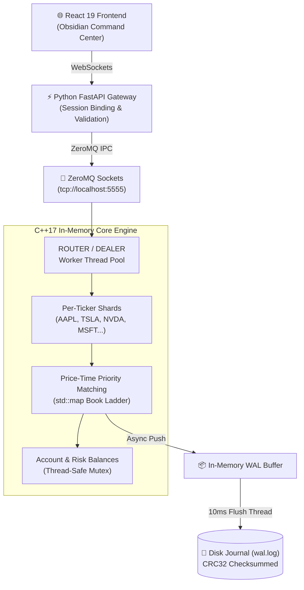

<p align="center">
  
  
  
  
  
</p>

<h1 align="center">TradeVerse</h1>

<p align="center">
  <strong>A multi-threaded financial order matching engine & market simulator</strong><br/>
  <sub>Built with C++17 | ZeroMQ | Write-Ahead Logging | React & FastAPI</sub>
</p>

<p align="center">
  
</p>


<p align="center">
  <a href="#quick-start">Quick Start</a> &middot;
  <a href="#architecture">Architecture</a> &middot;
  <a href="#features">Features</a> &middot;
  <a href="#trade-commands">Commands</a> &middot;
  <a href="#performance--testing">Performance</a> &middot;
  <a href="#known-limitations">Limitations</a> &middot;
  <a href="#authors">Authors</a>
</p>

---

## Overview

**TradeVerse** is an educational, research-oriented C++17 order matching engine designed to explore concurrency, thread-safety, crash-recovery, and low-latency network messaging. 

It implements per-ticker order books with price-time priority (FIFO), asynchronous Write-Ahead Logging (WAL) with CRC32 checksums, and a Python FastAPI / React WebSocket web interface communicating with a multithreaded ZeroMQ core.

> **Project Scope:** TradeVerse is a simulated matching core built to study distributed systems concepts (WAL durability, TOCTOU risk checks, idempotency, sharded order books). It is not a production-certified exchange engine.

---

## Quick Start

### Prerequisites

| Dependency | Purpose | Install |
|---|---|---|
| **g++** (MinGW/MSYS2 or GCC) | C++17 compiler | `pacman -S mingw-w64-x86_64-gcc` |
| **libzmq** | ZeroMQ messaging | `pacman -S mingw-w64-x86_64-zeromq` |
| **Python 3.10+** | Gateway & test scripts | [python.org](https://www.python.org/) |
| **Node.js 18+** | React web frontend | [nodejs.org](https://nodejs.org/) |

### Running the System (3 Terminals)

**Terminal 1: C++ Matching Engine**
```bash
g++ -O3 -std=c++17 backend/cpp/server.cpp -o backend/cpp/server.exe -lzmq -lws2_32 -lmswsock -ladvapi32
./backend/cpp/server.exe
```

**Terminal 2: Python FastAPI Gateway**
```bash
python backend/python/gateway_fastapi.py
```

**Terminal 3: React Web Frontend**
```bash
cd frontend
npm install
npm run dev
```

---

## Architecture



The system is separated into three distinct layers:
1. **Edge Client & Gateway:** A React browser client connects to a FastAPI gateway via WebSockets. The gateway validates session tokens and translates web actions into binary/IPC payloads.
2. **Matching Core (C++17):** Orders are routed over ZeroMQ to independent, per-ticker orderbook shards. Because each ticker maintains its own mutex and price ladder, orders across different symbols process without lock contention.
3. **Durability (Async WAL):** Executed trades are pushed into an in-memory queue and written to disk in 10ms batches by a dedicated background thread, keeping physical disk I/O completely off the hot matching path.


---

## Features

### 1. Order Matching & VWAP Execution
- **Limit Orders (`LIMIT_BUY` / `LIMIT_SELL`):** Matched against resting limit orders or added to the `std::map` price ladder.
- **Market Orders (`BUY` / `SELL`):** Aggressive orders sweeping across price levels, calculating true Volume-Weighted Average Price (VWAP).
- **Structured Results:** Return typed `OrderResult` structs (`filled`, `avg_price`, `success`, `message`) directly to callers.

### 2. Risk & Account Checks (TOCTOU Prevention)
- In-memory account tracking (`Account` struct with cash and holdings).
- Pre-trade validation reserves estimated cash/shares under `accounts_lock` prior to matching, preventing double-spend race conditions.
- Fills settle makers and aggressors; unused reserved funds are refunded automatically on rejection or cancellation.

### 3. Asynchronous Write-Ahead Log (WAL)
- Non-blocking logging: Order execution threads push `WalEntry` records to an in-memory queue.
- Background worker `async_wal_writer_thread` writes records to `logs/wal.log`.
- Log records include CRC32 checksums (`action|ticker|qty|price|timestamp|crc32`) to detect corrupted records on startup.

### 4. Idempotency & Deduplication
- Request IDs (`req_id`) sent by clients are cached in an in-memory `dedup_cache`.
- Retried network requests return cached execution responses without re-running matching or double-charging accounts.

---

## Trade Commands

| Command | Format | Example | Description |
|---|---|---|---|
| **Register** | `REGISTER:<CLIENT_ID>` | `REGISTER:user1` | Create account with default $100,000 balance |
| **Market Buy** | `BUY:<CLIENT_ID>:<TICKER>:<QTY>[:<REQ_ID>]` | `BUY:user1:AAPL:10` | Execute market buy with account risk validation |
| **Market Sell** | `SELL:<CLIENT_ID>:<TICKER>:<QTY>[:<REQ_ID>]` | `SELL:user1:TSLA:5` | Execute market sell with holdings validation |
| **Limit Buy** | `LIMIT_BUY:<CLIENT_ID>:<TICKER>:<QTY>:<PRICE>` | `LIMIT_BUY:user1:AAPL:10:220.50` | Place resting limit buy order |
| **Limit Sell** | `LIMIT_SELL:<CLIENT_ID>:<TICKER>:<QTY>:<PRICE>` | `LIMIT_SELL:user1:NVDA:5:145.00` | Place resting limit sell order |
| **Cancel Order** | `CANCEL_ORDER:<TICKER>:<ORDER_ID>` | `CANCEL_ORDER:AAPL:7` | Cancel resting limit order |
| **View Book** | `ORDERBOOK:<TICKER>` | `ORDERBOOK:GOOGL` | View bid/ask price depth |
| **Account Info** | `ACCOUNT:<CLIENT_ID>` | `ACCOUNT:user1` | View cash balance and holdings |

---

## Performance & Testing

Testing is conducted using Python closed-loop multi-processing scripts (`stress_test.py`, `benchmark.py`).

### Windows Environment (Sample Run)
- **Concurrency:** 10 worker processes, 2,000 orders each (20,000 total requests)
- **Throughput:** ~11,000 to 12,500 orders/sec
- **Round-Trip Latency (p50):** ~0.55 ms – 0.95 ms
- **Round-Trip Latency (p99):** ~1.00 ms – 2.80 ms

*Note: Throughput and latency measurements represent closed-loop round-trip time over ZeroMQ sockets including client serialization and server response handling.*

---

## Known Limitations

| Area | Detail |
|---|---|
| **Account Persistence** | Account balances and holdings live in memory (`account_manager.hpp`). On server restart, accounts reset to initial defaults. |
| **Cancel Ownership** | `CANCEL_ORDER` matches order ID within a ticker shard, but does not currently check if the caller owns the order. |
| **Order Book Recovery** | The WAL records executed trade fills for auditing/volume tracking. Resting limit orders in the book are not saved to disk and reset on restart. |
| **No Authentication** | Client identity (`client_id`) is self-declared by the client string. Authentication & token validation belong in the API Gateway layer before reaching the matching engine. |
| **Shared Account Lock** | All account updates synchronize through a single `accounts_lock` mutex, creating contention across tickers for shared accounts. |

---

## Authors

- **Shaurya** ([@shaurya212121](https://github.com/shaurya212121))
- **Pranshu** ([@pranshup04](https://github.com/pranshup04))
